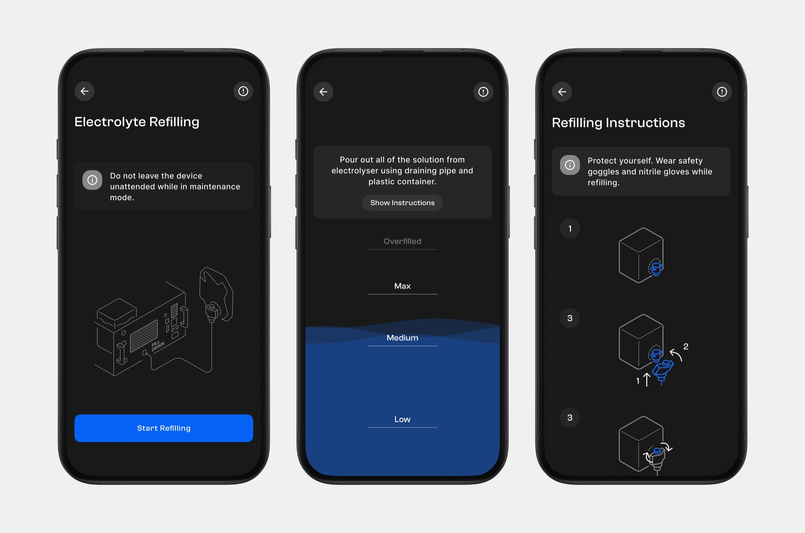
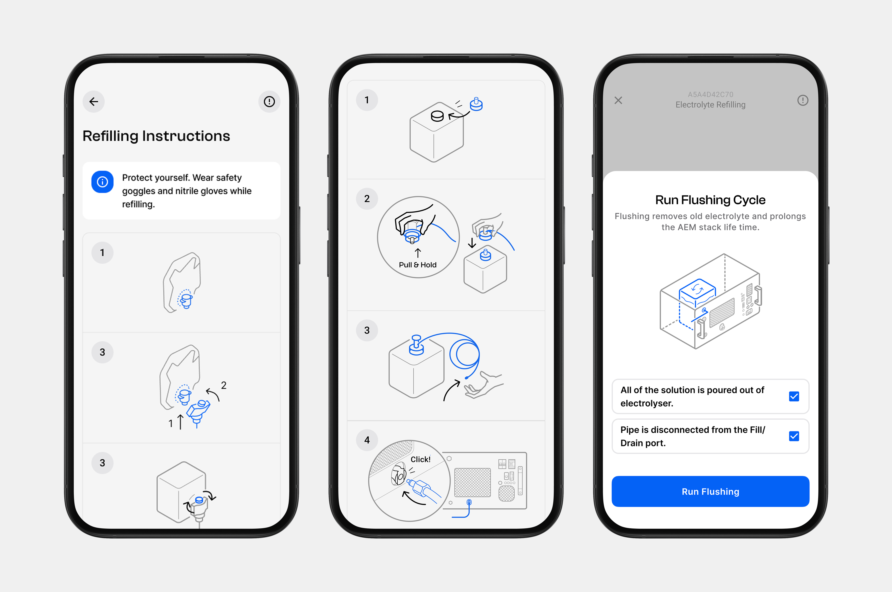
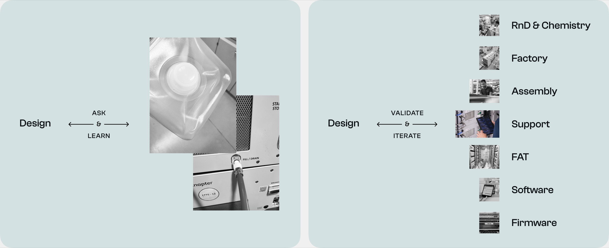
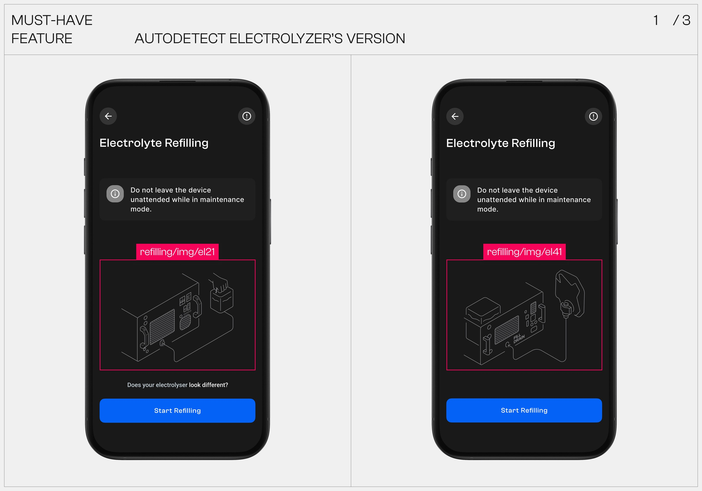
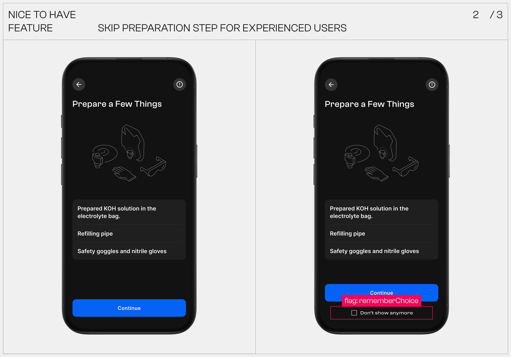
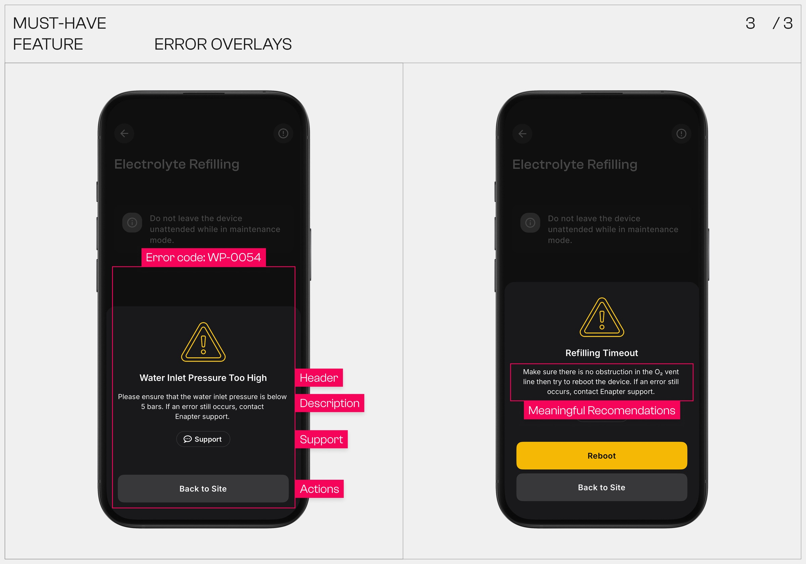
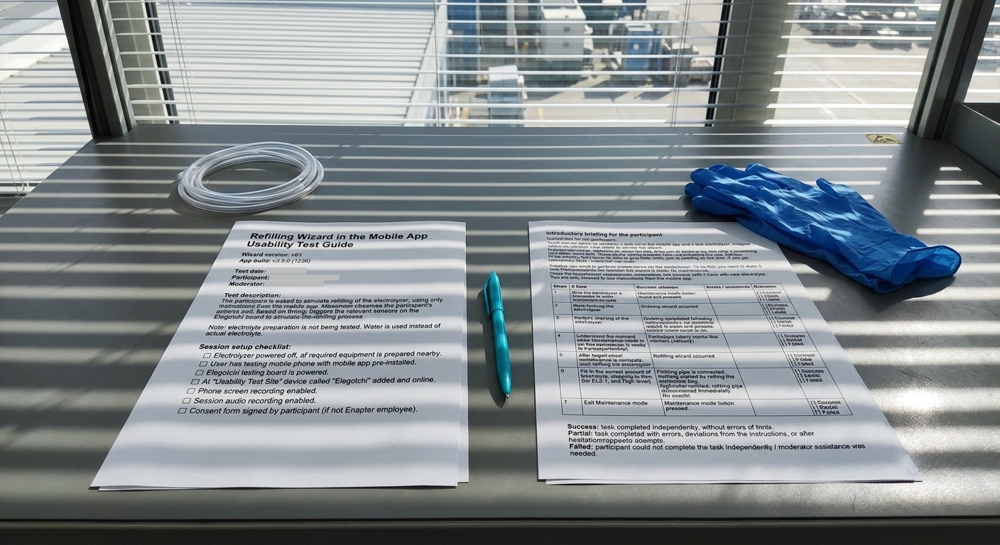
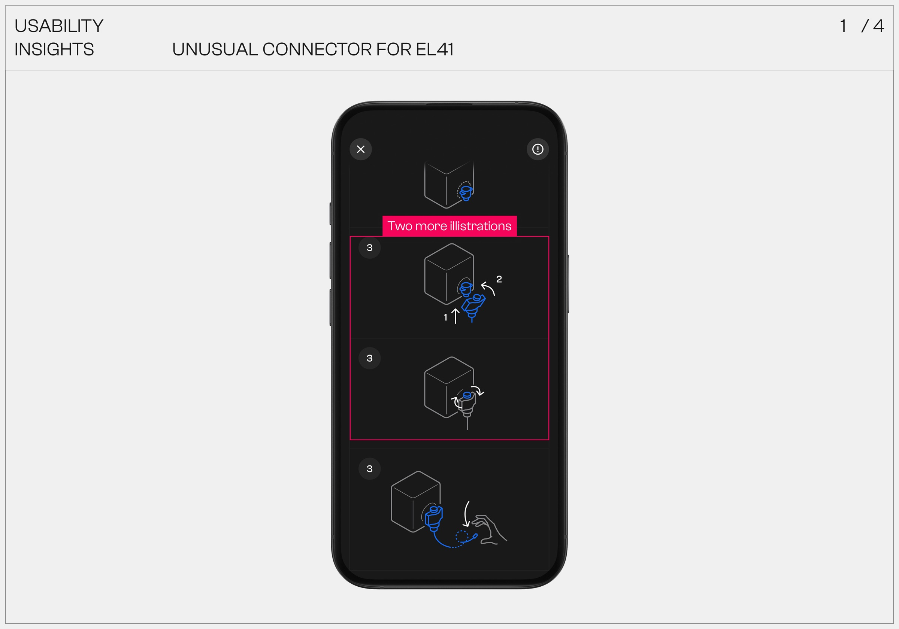

{wide}

{h2} Исходная ситуация

1. 80% клиентов обращались в поддержку с вопросами о рефилинге сразу после получения оборудования.
2. Для обслуживания приходилось сверяться с объёмными бумажными руководствами.

{h2} Предложенное решение

1. Добавить пошаговые инструкции в мобильные приложения Enapter и [веб-интерфейс электролизёра](# "Интерфейс встроен в прошивку и позволяет управлять устройством на месте.").

{wide}

{h2} Почему это важно

1. Рефилинг — первое, что делает оператор после установки оборудования.

2. Рефилинг приходится повторять. Перед обслуживанием или перевозкой электролит сливают, а затем заливают снова.

3. Большинство операторов впервые работают с водородным оборудованием.

{h2} Исследование

  
Материалы этапа

  
<a href="src/usability-testing-guide.docx" title="button">  PRD (скоро) ↗</a>

На старте у нас была только проблема. Документации и готовой постановки задачи ещё не было.

1. Я изучила более 1500 обращений в поддержку и сформулировала проблему.
2. Обсудила идеи с отделом исследований и производством, уточнила особенности будущей модели EL4.1.
3. До первых прототипов провела серию встреч с инженерами и разработчиками прошивки.

{wide}

{h2} Дизайн и разработка

  
Материалы этапа

  

    <a href="src/usability-testing-guide.docx" title="button"> Сценарий в FigJam (скоро) ↗</a>
    <a href="src/usability-testing-guide.docx" title="button"> Макеты в Figma (скоро) ↗</a>
  

Я объединила результаты исследования в план MVP и наметила дальнейшее развитие пошаговых инструкций.

1. Помимо макетов в Figma, я разработала схему хранения и версионирования инструкций на статическом сервере. Приложение подбирает инструкцию по версии электролизёра.
2. Для каждого кода ошибки я подготовила понятный заголовок и шаги по устранению проблемы. Описания собрала в GitLab.

{carousel}

{/carousel}

{h2} Как мы тестировали прототип

  
Материалы этапа

  
<a href="src/usability-testing-guide.docx" title="button"> testing-guide.docx ↓</a>

Для запуска электролизёра нужны трубопроводы и вспомогательное оборудование. Найти свободную установку было самым сложным в пользовательском тестировании и QA.

Мы разработали Elegotchi — печатную плату, которая имитирует работу электролизёра.

{wide}

Как проходило тестирование

1. В ранней бете участвовали сотрудники Enapter. Позже мы получили доступ к площадкам внешних интеграторов.
2. Мы просили участника выполнить рефилинг электролизёра, пользуясь только подсказками мобильного приложения.
3. Для физических действий использовали выключенный электролизёр и [комплект для рефилинга](# "Канистра и трубки для рефилинга и слива.").
4. Модератор наблюдал за действиями участника и вовремя активировал датчики на плате Elegotchi, имитируя процесс рефилинга.

{wide}

{h2} Что показало тестирование

  
Материалы этапа

  
<a href="src/usability-testing-guide.docx" title="button"> testing-insights.docx (скоро) </a>

Примеры изменений по результатам тестирования.

{carousel}

{/carousel}

{h2} Результаты

1. Число первичных обращений по поводу рефилинга снизилось практически до нуля.
2. [96% процедур рефилинга](# "По данным Google Analytics (Firebase) за шесть месяцев после выпуска.") через мобильное приложение прошли успешно.
3. Среди оставшихся 4% преобладали сбои оборудования и датчиков.